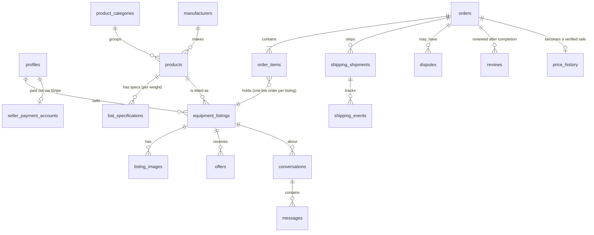

# Database guide

The schema is in `supabase/migrations`, applied in order:

| File | Contents |
| --- | --- |
| `…0100_foundation.sql` | Helper functions, user roles, profiles (created automatically at sign-up), categories, manufacturers, products, bat specifications, catalog submissions, settings, fees |
| `…0200_marketplace.sql` | Listings and photos (with publishing rules), favorites, offers, saved searches, watchlist, conversations, messages, blocks, reports, notifications |
| `…0300_transactions.sql` | Addresses, orders and order items, payout accounts, shipments and tracking events, webhook events, disputes, reviews, price history, subscriptions, advertising, newsletter, audit log |
| `…0400_security.sql` | Row Level Security policies, column privileges, the public seller-stats view |
| `…0500_storage.sql` | Photo buckets and upload rules |
| `…0600_new_bat_signals.sql` | Product release dates, product lineage, owner reports ("first swings"), review-maturity and durability views, review alerts, the private ownership-proof bucket |

## How the main tables connect

## Design decisions

- **Money is stored in whole cents** (`*_cents` columns), matching Stripe. This avoids rounding errors.
- **Fees live in `fee_configuration`.** Each order keeps a `fee_snapshot`, so changing a fee never changes past orders, and every change is written to the audit log.
- **Product vs listing.** A product is a model (for example, 2026 Miken Freak Black Maxload USSSA). A listing is one seller's item. Many listings can point at one product.
- **Category-specific fields.** `product_categories.attribute_schema` defines each category's listing fields, and listings store their values in `attributes` (JSON). New categories need no code changes.
- **Stamps are a list** (`certification_association text[]`), because dual-stamp bats carry several.
- **Unknown stays unknown.** Spec columns can be empty, and `verified` and `certification_status` record whether anyone has checked them.
- **Selling twice is impossible.** A unique index allows only one live order item per listing.
- **Only real sales count.** Price history accepts verified rows only from completed marketplace orders (or a documented licensed source).
- **Writes go through the server.** Orders, payments, shipments, webhooks, notifications and moderation decisions are written by server code using the service role key, never directly by browsers.

## Who can see what

| Data | Visitors | Members | The parties | Staff |
| --- | --- | --- | --- | --- |
| Public profile fields, published catalog, live listings, published reviews, verified sales, active fees | ✓ | ✓ | ✓ | ✓ |
| A member's email, ZIP code, addresses, favorites, saved searches | | own only | | support |
| A listing's ship-from ZIP | | seller only | | support |
| Orders, shipments, disputes | | | buyer and seller | support |
| Buyer's ship-to address | | | seller, once paid | |
| Messages | | | the two participants | (moderation access arrives in Phase 5, audited) |
| Webhooks, newsletter list | server only | | | |
| Audit log | | | | admins (read-only for everyone) |

`tests/db/security.test.ts` checks every row of this table against a real database.

## New bat signals

New models have no reviews yet, so `…0600_new_bat_signals.sql` adds honest early signals. Every number comes from rows in the database; nothing is estimated.

- **`products.release_date` / `release_status`** stay empty until known. `product_review_maturity` classifies each published model as `new_release` (announced, on pre-order, or released within `new_release_window_days`, with fewer than `early_report_threshold` owners reporting), `early_reports` (still in the window, threshold reached) or `established` (past the window). With no release info it is `null`.
- **`product_lineage`** links a model to its predecessor, same-platform or variant models, with a confidence, the basis and a source. Public when both models are published; written by the server only.
- **`owner_reports`** are dated check-ins from owners (hits, ball, pop vs. previous gamer, sting, durability). One per member per model every `owner_report_interval_days` (7). Members can't set `ownership_verified`, `status` or `created_at`: a trigger verifies ownership when the member has a completed marketplace order for the model (also when the order completes later), and staff can verify from a proof photo. Published reports are public; hidden ones are visible to their owner and moderators.
- **`owner_report_durability`** shows, per model with at least `durability_min_owners` (3) reporting owners, each owner's latest status, cracks and rattles, and median hits. Aggregates only, no user ids.
- **`review_alerts`** are private to their owner. The server's notifier sets `last_notified_at`.

`tests/db/new-bat-signals.test.ts` covers these rules.

## Making changes

1. Add a new file to `supabase/migrations` with a later timestamp. Never edit a migration that has already run in production.
2. Run `npm run test:db` locally.
3. Apply it to the hosted project with `npx supabase db push`.
